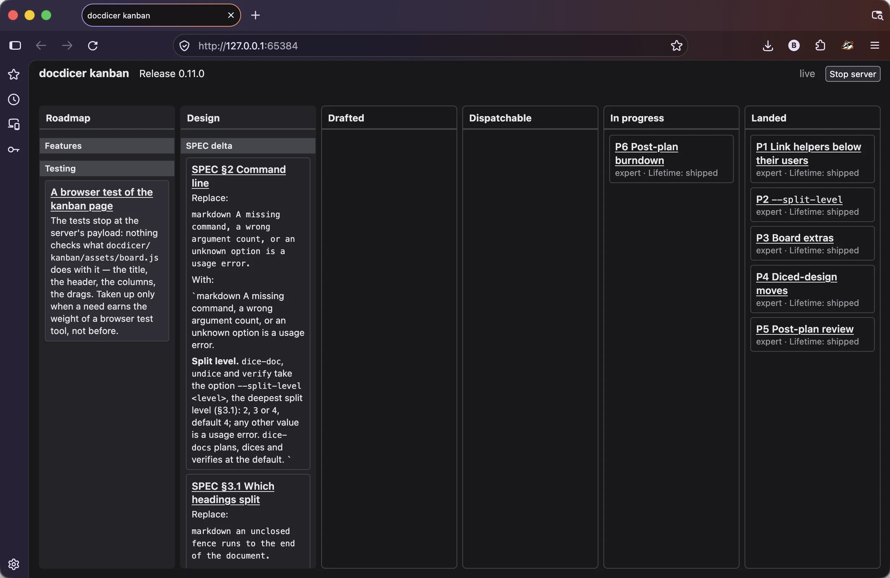

# docdicer

A stdlib-only python 3.9 tool for transforming and viewing project markdown documents to facilitate AI-assisted development

- Bidirectional transformation of heavy monolithic markdown documents to and from context-friendly file hierarchy
  - Permanent project documents (SPEC, ARCHITECTURE, CONVENTIONS)
  - Working design and plan docs 
- Checks a roadmap, a plan and a design against the forms the tools read (`check-roadmap`,
  `check-plan`, `check-design`), and the links and structure of a diced tree
- Serves a kanban display of the roadmap, parked designs, active designs and plans

docdicer's capabilities are used in its own development.




## Requirements

Python 3.9 or later, standard library only. The dicing commands take every input as an argument and name nothing
specific to a repository; run them from the directory the documents' relative links are written against.

## Developer

<https://keyoxide.org/wkd/benn@bennherrera.dev>

## Installation

docdicer is primarily used via integration into [devpro](https://github.com/benn-herrera/devpro)

Can be directly installed via pip:
```bash
pip install git+https://github.com/benn-herrera/docdicer
```

## Tools

One CLI, `python3 -m docdicer <command> ...` with this repository's root (the directory holding
the `docdicer` package) on `PYTHONPATH`; installed with pip, the same CLI is the `docdicer`
command. `python3 -m docdicer --version` prints the version; `-h`,
on its own or after a command, prints help. Exit status is 0 on success, 1 when a check or step
fails, 2 on bad arguments.

- `dice-doc [--split-level <level>] <monolith.md> <out-dir> [map.tsv]` dices one document and runs
  the checks below. `out-dir` must be absent or empty. `--split-level` (`2`, `3` or `4`, default
  `4`) is the deepest heading level that splits (see Heading convention).
- `undice [--split-level <level>] <tree-dir> <monolith.md>` writes a diced tree back out as one
  document: section links return to `§N`, links to a heading's file return to `#anchor`, other
  relative links are rebased to the run directory. It then checks that dicing the result reproduces
  the tree, Contents blocks aside, reporting any `.md` the tree holds that it would not write,
  naming the rename, heading edit, Contents edit or removal that fixes it. `monolith.md` must not
  exist. Give it the `--split-level` the tree was diced at.
  The result need not equal the original source; a title holding `]` or unbalanced brackets, for one,
  yields a malformed Contents link that `undice` reports as not reproduced (SPEC §10).
- `dice-docs <manifest.tsv> <src-dir> <work-dir>` drives several documents, each diced at the
  default split level (`4`): link map, dice each, group indexes and entry point, verify. The link
  map `links.tsv` goes to `<work-dir>`; output directories not nested in another output are removed
  first. A manifest row flagged anything but `entry` ends the command, exit 2, before anything is
  written. See Worked example for a manifest.
- `verify [--split-level <level>] <map|-> <monolith> <out-dir> ...` re-runs the checks on built
  trees, diced at that split level, once every tree a link points into exists. Exit 1 if any check
  fails.
- `check-links <root>...` checks markdown files that need not come from a dicing: a directory
  root is walked for every `.md`, a file root is checked alone. Each relative link or image
  outside fenced code and code spans must name an existing path, resolved from the linking file's
  directory; one with a `#fragment` must name a markdown file (the linking file itself, for a bare
  `#fragment`) with a heading whose GitHub anchor equals it. The anchor is the heading text
  lowercased, with every character but letters, digits, spaces, `-` and `_` dropped and spaces
  made `-`, all on the heading's plain text (see Heading convention); a repeat in one file takes `-1`,
  `-2`, … in order. It is not a leaf's file-name slug.
  Headings inside fenced code have none. Links with a URL scheme and root-absolute `/` links are
  skipped. Prints `file:line: target: missing file` or `missing anchor` to stderr per broken link,
  then the count; exit 1 if any is broken, 2 on bad arguments, a missing root or an unreadable file.
- `check-tree <root>...` checks a diced tree's structure, which no link check sees: every
  document is linked from its parent, and every document is reachable by links from the root's
  `entry-point.md`. A directory's head is its `entry-point.md` where it has one (the root, a diced
  volume), else its `index.md`; a document's parent is its directory's head, and a head's parent
  is the head above it. A leaf that its index stopped listing fails even where another document,
  such as the entry point's contents, still links it. Exit 1 on any problem, 2 on bad arguments,
  a root that is not a directory, or an unreadable `.md` under one.
- `check-plan [<plan>]` checks that a development plan is in the form a program can read: a status
  table under `## Status` whose `Package` and `State` columns hold unique IDs without spaces and
  states opening with `dispatchable`, `in progress` or `landed` (an empty cell is a drafted
  package), and a `Rating` column whose cells open `mechanical` or `expert`, and a
  `Release: <version>` line, where present, first after the H1 heading. A package's title is the
  text after its ID in its heading. A package whose title opens `Post-plan review` is allowed only
  with one whose title opens `Post-plan burndown`, and the reverse. `<plan>` is a
  monolith or a diced plan's `entry-point.md`; without it the active plan is checked, `ACTIVE_PLAN.md`
  else `ACTIVE_PLAN/entry-point.md` under the nearest ancestor directory holding `.git`. Absence is
  valid: no status table, or no active plan, exits 0. Prints
  `file:line: problem: found <text>; accepted: form` to stderr per breach, in reading order, `<text>`
  being the text found in a code span (`` found `text` ``), or `an empty cell`; then
  `plan checked: <plan>, work packages: <N>, problems: <P>`; exit 1 on any breach, 2 on a `<plan>`
  that is not a file, no project root, or an unreadable plan file.
- `check-design [<design>]` checks that a design is in its final form, ready to plan from; a design
  still in progress fails it. A design holds one to three level-2 delta sections headed exactly
  `SPEC delta`, `ARCHITECTURE delta` and `Code delta`, each at most once and in that order, and no
  other level-2 heading. The design is read in the ticket layout `check-roadmap` checks, each of its
  breaches a breach of the design: a delta is a category, and its entries are its tickets; a delta
  with no entries is valid, but a line before its first entry is not. Lines outside a delta are free
  except a level-2 heading and what the layout does not admit. Whether an entry's link resolves is
  `check-links`'s to say. `<design>` is a monolith or a diced design's
  `entry-point.md`; without it the active design is checked, `ACTIVE_DESIGN.md` else
  `ACTIVE_DESIGN/entry-point.md` under the nearest ancestor directory holding `.git`. A diced design
  is read in document order, following the links of each head file's last `Contents:` list. Prints
  `file:line: problem: found <text>; accepted: form` to stderr per breach, in document order, then
  `design checked: <design>, entries: <N>, problems: <P>` to stdout; exit 1 on any breach, 2 on a
  `<design>` that is not a file, no project root, or an unreadable file of the design. No active
  design prints `no active design in <root>` and exits 0.
- `check-roadmap [<roadmap>]` checks that `ROADMAP.md` is in the ticket layout the board reads: a
  category is a level-2 heading and its lines; a ticket is a level-3 heading inside a category and
  its lines, up to the next heading of level 1 to 3, deeper headings being part of its text; every
  other line is free. A level-3 heading outside any category, a ticket heading whose text, links
  reduced to their text, is empty, a roadmap with no category, and a line outside any ticket opening
  in column 0 with a list marker (`-`, `*`, `+`, `1.` or `1)`), a space and `**` (the old ticket
  form) are breaches. Fenced code is not read. `<roadmap>` is one file, whatever its name; without
  it `ROADMAP.md` under the nearest ancestor directory holding `.git` is checked, and none there
  prints `no roadmap in <root>` and exits 0. Prints
  `file:line: problem: found <text>; accepted: form` to stderr per breach, in line order, then
  `roadmap checked: <roadmap>, tickets: <N>, problems: <P>` to stdout; exit 1 on any breach, 2 on a
  `<roadmap>` that is not a file, no project root, or an unreadable roadmap. A `ROADMAP.md` in the
  layout, the second ticket linking a parked file:

  ```markdown
  # ROADMAP

  ## General

  ### Cache the link map

  Rebuilding it on every run is slow on large trees.

  ## Later

  ### Export to HTML

  [export-html](ROADMAP_DESIGNS/export-html.md)
  ```
- `kanban [<project-dir>]` serves a live board of a project's development-process files on
  `127.0.0.1`: it prints `http://127.0.0.1:<port>/` on stdout; open that URL in a browser and stop
  the server with Ctrl-C or the page's stop button (exit 0), which asks no confirmation and ends
  the page's polling. The server answers only requests naming its own host. `<project-dir>` is any
  directory inside the project; without it the project is the one the current directory is in. The
  page follows edits to the files without a reload; the board keeps no state of its own. Its
  connection indicator shows the server's docdicer version as hover text. Exit 2 on a directory that
  does not exist, no project root, an unreadable file at start, or a port that cannot be bound.
  - Columns: Roadmap (`ROADMAP.md`'s tickets, and each piece of parked work in `ROADMAP_DESIGNS/`
    that no roadmap ticket links, unless its link ticket is in the active design), Design (the
    active design's tickets) and, from the active plan's status table, Drafted, Dispatchable, In
    progress and Landed. Parked work is a `.md` file there other than `README.md`, or a
    subdirectory holding its own `entry-point.md`; its parked name is the file name without `.md`,
    or the directory name. Pieces group by topic: `<topic>_DESIGN`, `<topic>_PLAN` and
    `<topic>_PLAN_REVIEW` make a topic, and every parked name that is `<topic>` or opens with
    `<topic>_` joins it, the longest topic where it fits more than one. Each piece shows as one
    parked card, titled by its parked name (a grouped piece's is its topic), under a
    `ROADMAP_DESIGNS` band.
    A link ticket is a design ticket outside the deltas that stands for a piece of parked work: its
    heading, a link to each of the piece's files, and `complete and update this design`. Where one
    is in Design, the piece shows there as a card, not in Roadmap; a link ticket dropped on Roadmap
    is removed and the parked card shows in Roadmap again.
  - Links: each card's title links to the file and heading it shows, opening in a new tab; a parked
    card links each of its files, and a link ticket's card its heading and each of those files. A
    package card links the heading its title is read from, an untitled one its status row's file.
    The server serves exactly the files the board reads, read-only; each response is `no-store` and
    `nosniff`, and the pages and markdown also carry a Content-Security-Policy (ARCHITECTURE §5,
    **Headers.**).
  - Layout: both documents are read in the ticket layout `check-roadmap` checks. Each category is
    a separator band and each ticket a movable card titled over its text; in Design, the tickets of
    a `SPEC delta`, `ARCHITECTURE delta` or `Code delta` category (see `check-design`) are entry
    cards, which cannot be dragged.
  - Notices: each breach `check-roadmap` would report in `ROADMAP.md`, and each layout breach in
    the design, shows as a notice at the head of its column. Lines above the first category, and a
    category's lines before its first ticket, are not shown and raise no notice.
  - Moves: the page's only writes are the moves made by dropping a card: a ticket's, its lines
    carried as written but for relative links, which are rebased to resolve from the file the
    ticket joins, between `ROADMAP.md` and the active design, a single file or a diced tree, after
    which it is in exactly one of the two; a parked card's link ticket added to the design; a link
    ticket removed. A `#anchor` link stays as written, so it breaks if its heading is not carried or
    its anchor changes in the file joined; `check-links` reports it. The board does not reorder
    tickets, move one between categories of a document, or edit any ticket's or category's text. A
    move creates an absent `ACTIVE_DESIGN.md` or `ROADMAP.md`, and the page then shows a move
    message naming the files written.
    - A Roadmap card dropped on Design goes to the end of the design's `## Drafts` category (added
      where there is none). In a diced design, where `## Drafts` opens an `index.md` the ticket
      becomes a new leaf beside it; where there is no `## Drafts`, a new leaf in a `drafts/`
      directory beside `entry-point.md`, with its own `index.md`; where `## Drafts` is elsewhere in
      the tree, the ticket is added in the file holding it. A new leaf is listed in the Contents
      blocks that list its directory.
    - A parked card dropped on Design adds its link ticket to `## Drafts` the same way, a new leaf
      in a diced design too, touching neither the parked work nor `ROADMAP.md`.
    - A movable Design card dropped on Roadmap goes to the end of the category whose band is
      nearest above the drop, else the first (`## General` where `ROADMAP.md` has no category). A
      link ticket dropped there is removed and nothing is added. In a diced design, a leaf holding
      only the ticket is deleted, and its lines in the Contents blocks removed.
    - A ticket moved to `## Drafts` fails `check-design` until the design reaches its final form.
  - Refusals: a move is refused, and nothing written, if a file changed since the board read it, the
    card is no longer on the board, a document it reads is unreadable (`cannot read: <file>`), or
    an entry card or separator is dropped on Roadmap. In a diced design, it is also refused where a
    new leaf's title gives no file name, a file the move would create exists, a leaf to delete is
    missing from its directory's Contents block, or a ticket's text runs on into the next file; a
    ticket whose title holds `]` moved into a diced design cannot move back, its leaf having no
    Contents line. A write that fails is reported as `cannot write: <file>` with the files already
    written: the addition is written before the removal, so the ticket ends in both documents,
    never neither.
  - Plan columns: read-only, drawn as outlined boxes of flat cards against the filled, draggable
    Roadmap and Design cards. A work package's state changes by editing the plan, and the board
    shows the edit.

The roadmap, plan and design reader, `check-roadmap`, `check-plan`, `check-design`, the board model and its server live in `kanban/`;
ARCHITECTURE §2 maps both packages module by module. The passes behind the dicing commands live in
`dicerlib/`, one module each: `outline` (headings to files), `anchors` (GitHub heading anchors),
`split` (writing the tree), `linkrewrite` (section links, rebasing, the map), `reassemble` and
`linkcheck` (the checks, `check-links` included), `treecheck` (`check-tree`), `dicedoc` and
`manifest` (the drivers), with `heads` (head-file names), `textfile` (file I/O and fenced code) and
`linkscan` (the one line scanner, the reducer of links to their text and the collector of link
targets) beneath them all. `just test` runs one pytest test per golden case under
`docdicer/test/data/`, one `undice` round trip per case that dices without a map and succeeds, and
the per-module unit tests; `just build` builds a wheel into `dist/`.

## Heading convention

`#` title, then `##` sections, `###` subsections, `####` sub-subsections; deeper headings and
headings inside fenced code are text. `####` is the deepest split at the default; `--split-level 3`
makes it `###` and `--split-level 2` makes it `##`, deeper headings staying text in their section's
file. A heading's number, title, file name and anchor come from its
text with each link reduced to its text: `### [Plan Status Form](x)` is titled `Plan Status Form`,
named and anchored `plan-status-form`. A heading starting `N.` or `N.M` is numbered: its file is
`<number>-<slug>`, and `§N`, `§N.M` in prose link to it. Any other heading is named by its slug.
A heading with children becomes a directory with an `index.md`; otherwise one leaf file. Leaves
hold exactly the original lines, heading included. Sibling headings with the same slug would write
the same file, so they are an error and the run fails. Text before the first heading that splits
is `entry-point.md` with a `Contents:` list.

## Head-file names

A tree's root and each diced volume open at `entry-point.md`; every other directory opens at
`index.md`. These names are fixed, not options: a reader moving between projects finds any tree's
way in by them. `dicerlib/heads.py` holds them, and every pass reads them from there. `check-tree`
reports a tree laid out any other way.

## Link rewriting and the map

`§N` links to its file; followed by a backticked name, it goes to the child whose heading holds that
name. A `§N` right after `SPEC `, `ARCHITECTURE `, `THESIS ` or `CONVENTIONS ` is left as
text (another document's section). A link to a heading of the document itself, `#anchor`, goes to
the file now holding that heading: to the file alone where the heading opens it, else with the
heading's anchor within that file. An anchor that names no heading is left as written, for
`check-links` to report. Relative links to files outside the document are rewritten to resolve from
each leaf. The map is TSV: `<target>\t<new path from the run directory>` points a link
to a diced document at its entry point; `<target>\t<heading>\t<path>` points a link whose
following text quotes that heading, as `, "The walk"`, at the heading's leaf.

## Manifest (`dice-docs`)

Tab separated: `file`, `outdir`, `flags`, `label`; blank lines and lines starting `#` are skipped.
Flags (comma list, may be empty): `entry`, the only flag (the file is copied verbatim to
`<outdir>/entry-point.md` with a `Volumes:` list of the volumes directly under `<outdir>`, each with
the first sentence of its opening paragraph, as plain text; it is not diced). A volume nested as
`<parent>/<group>/<name>` takes the group's title in `label`; the group gets an `index.md`, each of
its volumes listed by the plain text of its document's title, and the parent's entry point gains a
line for it (SPEC §7.1). Parents precede children. Documents link to each other by
`file` as written in the manifest; the `entry` document by its base name.

## Checks

- Reassembly: concatenating the leaves in order, with the added `Contents:` blocks removed and
  section links reverted, reproduces the monolith's lines exactly (outside links are compared in
  their rewritten form). Proves nothing was lost, moved or edited.
- Links: every link in the output, root-absolute `/` links and links with a URL scheme skipped, resolves
  to an existing file from the linking file's directory. Proves the tree and the cross-document map
  are consistent; it does not check `#anchor` fragments, which `check-links` does.

## Worked example

kbase's `PROJECT_DOCS/` is produced from its root documents, their sections already in headings,
with this manifest (tab separated), the sources copied from `HEAD` into a scratch directory, run by
kbase's own `dice-docs` justfile target:

| file | outdir | flags | label |
|---|---|---|---|
| THESIS.md | PROJECT_DOCS | entry | |
| SPEC.md | PROJECT_DOCS/SPEC | | |
| ARCHITECTURE.md | PROJECT_DOCS/ARCHITECTURE | | |
| CONVENTIONS.md | PROJECT_DOCS/CONVENTIONS | | |
| RIGOR_AND_BEARING_SCORING_SCHEME.md | PROJECT_DOCS/SPEC/scoring/rigor-and-bearing | | Scoring schemes |
| STRENGTH_SCORING_SCHEME.md | PROJECT_DOCS/SPEC/scoring/strength | | |

    just dice-docs kbase-docs.tsv <src-dir> <work-dir>

The leaves under `PROJECT_DOCS/` are now the source; the root `SPEC.md`, `ARCHITECTURE.md`,
`CONVENTIONS.md` and `THESIS.md` are pointers to them.

## Third Party Acknowledgements

- **kanban from markdown** - idea from Jason Coleman (https://github.com/sangrail)
- **pytest** (the pytest developers, MIT): runs the test suite; installed into this repository's
  `.venv` by `just test`.
- **black** (Łukasz Langa and contributors, MIT): formats the Python source; installed into `.venv`
  by `just test` and run by `just format-python`.
- **isort** (Timothy Crosley and contributors, MIT): sorts Python imports; installed and run the same
  way.
- **flake8** (Tarek Ziadé and contributors, Python Code Quality Authority, MIT): lints the Python
  source; installed and run the same way.
